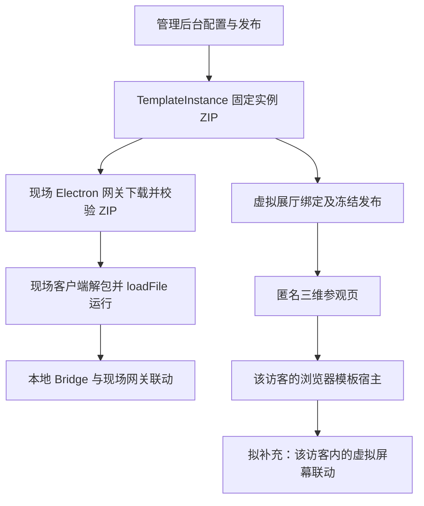

# 虚拟展厅跨项目架构核对与修订建议

日期：2026-09-30。状态：已按当前代码完成只读核对；用户已确认保留访客自己展厅内的软件联动，具体修订设计待审阅。尚未修改产品代码。本文补充 v0.3 方案及第一阶段交付，不把建议标为已经实现。

## 核对结论

原方案考虑了两个完整项目的模板内容关系：线上消费管理后台发布的既有实例 ZIP，现场网关和客户端继续消费该实例。第一阶段已接入这一关系。

但原方案把现场端主要作为保持不变的消费端，没有完整纳入现有跨屏函数联动、网关业务裁决、现场实际加载状态和旧模板产物的兼容范围。第一阶段的准确定位应为“共享云端内容实例的线上三维参观与单屏交互基础”，尚不能宣称与现场全部交互等价。原设计中的部分“尚未实现”描述也已落后于当前代码。

已确认的用户约束继续有效：公开参观、登录并授权编辑，复用模板和配置，每位访客独立操作、不影响线下，屏幕预览后点击放大，管理员预览后手动重新发布，电脑优先兼容手机。新增跨屏能力须限定在该访客自己的虚拟展厅内。

## 完整项目职责

| 项目/进程 | 现有职责 | 虚拟模块接入边界 |
| --- | --- | --- |
| mju-smart-show 的 Vue/Java | 模板配置、实例 ZIP 生成、素材、设备/主题、功能联动配置和后台管理 | 模型导入、场景编辑、来源选择、固定版本发布、公开参观及线上运行服务 |
| mju-smart-show/ruoyi-gateway | Spring Cloud 云 API 网关，HTTP 路由与鉴权 | 精确放行公开读取，管理接口仍鉴权；与现场网关是不同进程 |
| automatic_exhibition_setup_platform/gateway | 现场 Electron 网关，云内容拉取、SQLite、ZIP 缓存/分发、TCP 终端消息、函数联动及业务/硬件适配 | 沿用实体终端链路；如要证明现场实装版本，另补只读部署回执 |
| automatic_exhibition_setup_platform/client | 现场 Electron 客户端，下载/解包、全屏 BrowserWindow 加载模板、本地 SDK Bridge | 继续运行实体屏幕；参与模板兼容核对，按需回报加载状态 |
| auto-exhibition-template-sdk | 模板配置/值读取、函数与事件 API、宿主通信 | 本地与浏览器双宿主；业务 API 尽量一致，路由能力必须明确 |

`gateway/gateway-core` 有独立协议框架，但当前实际 Electron 主入口未观察到调用它。设计以 `gateway/electron/main.js` 的执行路径为依据，不能将 README 中的规划能力视为已接通。

## 实际内容链路

线上运行服务独立承载网页资源，不借用现场网关的 ZIP 下载接口服务匿名流量。现场网关无需为了当前浏览器参观需求成为公网运行服务。现场也显示本地三维展厅属于另外的需求，目前不自动加入。

## 证据与缺口

### 1. 已经接入同一内容实例

`DeviceThemeConfigServiceImpl.publishConfig` 上传实例 ZIP 后记录 `TemplateInstance`，再回写 `currentTemplateInstanceId`。[发布代码](C:/Users/Administrator/Desktop/mju-smart-show/ruoyi-modules/mju-showroom/src/main/java/com/mju/showroom/service/impl/DeviceThemeConfigServiceImpl.java:306)

新增 `VirtualScreenBindingService` 已从设备主题配置选择实例；`TemplateArtifactService` 下载同一个 ZIP、验证 MD5，并提取其中 config/valueMap 和资源。没有另造一套实例，也没有在展厅发布时调用线下 publishConfig。[绑定代码](C:/Users/Administrator/Desktop/mju-smart-show/ruoyi-modules/mju-showroom/src/main/java/com/mju/showroom/service/virtual/VirtualScreenBindingService.java:29)、[产物读取](C:/Users/Administrator/Desktop/mju-smart-show/ruoyi-modules/mju-showroom/src/main/java/com/mju/showroom/service/virtual/TemplateArtifactService.java:70)

现场网关只下载/缓存 ZIP，客户端负责解包，并在全屏 BrowserWindow 中直接 loadFile。[网关同步](C:/Users/Administrator/Desktop/automatic_exhibition_setup_platform/gateway/electron/template/template-sync.js:147)、[客户端运行](C:/Users/Administrator/Desktop/automatic_exhibition_setup_platform/client/electron/main.js:1787)

绑定界面目前为授权实例列表，缺少设备名、设备 code、主题名的清晰分组。建议补成“现场设备 → 主题 → 云端已发布实例”的选择，同时保留固定实例来源，避免多个设备使用同一模板时选错配置。

### 2. 云端发布与现场加载不等同

需要区分云端期望版本、网关已下载版本、客户端已成功加载版本、虚拟展厅草稿版本和公开版本。

目前线上更新提示比较 `sourceConfigId.currentTemplateInstanceId`，含义是“云端已发布内容有更新”。现场同步下载失败、离线、主题未激活或加载失败都可能使实际内容落后。已有一般设备上报，但尚未观察到可用于核验的实例/摘要/加载成功回执闭环。[现有更新检测](C:/Users/Administrator/Desktop/mju-smart-show/ruoyi-modules/mju-showroom/src/main/java/com/mju/showroom/service/virtual/VirtualScreenBindingService.java:49)

修订建议：先准确展示“内容源 / 草稿 / 公开版本”，来源失效也提示；如果要求严格对照现场当前实装，再增加只读回执，记录 gatewayId、clientId、themeId、configId、templateInstanceId、artifact 摘要、下载/加载状态、观察时间和错误。回执不能写入或控制设备。只在客户端确认模板加载成功后标为加载完成，不用网关整轮同步成功或本地 currentDisplay 字段代替。

### 3. 单模板交互未覆盖现场跨屏联动

现场 Bridge 支持 local，以及交给网关处理的 binding/unicast/multicast/broadcast。这些路由模式可以指向模板、硬件或网关业务，不能把非 local 全部理解成硬件控制。[现场 Bridge](C:/Users/Administrator/Desktop/automatic_exhibition_setup_platform/client/electron/template/exhibition-sdk-bridge.js:361)

真实 Tbutton 模板通过 binding 调用其他端函数；抢答模板还依赖网关业务裁决。目前 browser transport 拒绝所有非 local，线上宿主只保留一个活动 runtime，并将事件回环到当前模板。[Tbutton 调用](C:/Users/Administrator/Desktop/template/Tbutton/src/App.vue:134)、[当前浏览器限制](C:/Users/Administrator/Desktop/auto-exhibition-template-sdk/src/runtime/communication/browserHostTransport.ts:106)、[当前宿主路由](C:/Users/Administrator/Desktop/mju-smart-show/ruoyi-ui-vue3/src/virtual-showroom/template-host/messageRouter.js:19)

建议按能力分类：

| 模板能力 | 当前基础版 | 修订处理 |
| --- | --- | --- |
| 单模板翻页、播放、内容选择 | 有原生/旧桥接路径，实际兼容仍待手测 | 保留、认证实际模板包 |
| 按钮触发其他虚拟屏幕 | 当前拒绝或无目标接收 | 推荐补访客内的软件路由与规则快照 |
| 抢答等网关业务裁决 | 当前未复用现场裁决 | 对明确需要的业务做访客独立适配，未适配时明确单机降级 |
| 串口/继电器/真实终端控制 | 线上禁止 | 保持不可用，禁止转发现场命令 |

建议的访客内联动：发布时仅导出已授权且已映射到虚拟屏幕的纯软件规则；公开规则只含虚拟身份，每个访客拥有自己的函数注册、消息路由及业务状态。未映射目标显式拒绝，不能退回真实 clientId。模板、硬件、网关业务端点分别处理，不按 target.mode 一刀切。

保留一个前台放大视窗；参与联动的其他模板按需启动、有限驻留，或通过明确的状态适配器运行。实例数量、隐藏媒体和资源释放必须有上限。当前“关闭即销毁、全局单活动 runtime”策略不能直接承诺维持跨屏状态，需要随联动设计调整；也不能无条件启动全部展项。

用户已选择保留访客自己展厅内的软件联动，因此修订不继续将跨屏模板统一降为仅预览。抢答等纯业务逻辑也使用该访客独立的房间/状态，不能借用现场抢答房间。不同线上访客之间多人同步不在本轮范围。

建议沿用 MessagePort 的来源/身份校验，增加展厅会话级宿主，区分“前台展示一个模板”和“有限驻留多个参与联动的运行实例”。每个 screen 的逻辑身份在该访客内保持稳定，runtimeId 仍按加载变化，用于拒绝旧消息。SDK 业务路由交给宿主判断，宿主只按已发布的软件规则及已注册函数分发；实体设备地址不会成为浏览器调用的回退目标。

发布时从管理员授权的现场软件规则生成虚拟规则快照，或由管理员显式配置虚拟规则。只有 source/target 已映射到本展厅屏幕的规则才能进入公开版本；一台现场设备映射到多个虚拟屏幕时要求明确选定目标，不按设备 ID 猜测。纯软件 gateway 业务进入受限的访客适配器；真实 hardware 端点始终拒绝。关闭放大窗口可保留参与联动的状态/有限运行实例，离开展厅时统一销毁。无法运行的目标返回明确错误，避免静默成功。

### 3.1 补充阶段的模块边界

| 模块 | 修订内容 | 位置 |
| --- | --- | --- |
| 来源选择与身份解析 | 设备/主题/配置/实例标签，实体身份仅作后台来源，显式虚拟屏幕映射 | mju-smart-show Java/Vue |
| 虚拟规则发布 | 授权校验、软件/硬件/业务端点分类、固定规则版本与模板实例一起发布 | mju-smart-show Java |
| 访客会话宿主 | 屏幕注册、逻辑身份、有限运行实例、函数/事件路由、请求结果、状态与退出清理 | 公开参观端 |
| 双宿主 SDK | 在浏览器模式允许声明的软件路由能力，保留原线下 Bridge；不同目标返回准确错误 | auto-exhibition-template-sdk |
| 抢答等业务适配 | 访客独立状态与裁决，使用明确业务 API，不连接现场网关 | 线上会话宿主或受限服务 |
| 现场版本回执（按需要） | 加载成功后上报实例/摘要/主题和错误，管理端只读展示 | 现场客户端、现场网关、mju Java |

“现场版本回执”不作为软件联动的前置条件；现阶段保持原来的云内容源更新提示，明确标注现场实装状态未知。若要求云端与现场实际内容严格对照，再细化这一项。

### 4. 旧模板 ZIP 不会随 SDK 源码自动升级

真实模板仍引用旧 SDK tgz/已安装 bundle；既有 ZIP 包含编译过的 JavaScript。新 SDK 源码和 dist 有 browser runtime，不等于旧 ZIP 已具有它。[Tbutton 依赖](C:/Users/Administrator/Desktop/template/Tbutton/package.json:12)

兼容判定应覆盖实际已发布 ZIP、npm SDK 与全局 ExhibitionSDK、相对 config/valueMap/媒体、函数/事件路由、业务写接口及持久状态。native 需要重建并重新发布模板实例；legacy-bridge 需要实际功能认证；无法适配的内容使用有说明的降级。握手成功只能证明通信建立。

## 身份映射

| 身份 | 含义 | 线上处理 |
| --- | --- | --- |
| device_info.id | 云设备数据库主键 | 仅后台来源绑定使用 |
| device_info.code / 现场 clientId | 实体终端的持久 UUID | 不作为访客可控制目标 |
| sourceConfigId / themeId | 配置来源与主题 | 发布前后台解析，公开数据剔除实体来源 |
| templateInstanceId + 摘要 | 固定内容产物 | 两端共用的内容依据 |
| screen.objectId | 虚拟场景展项标识 | 软件联动规则映射到该标识 |
| visitorSessionId | 独立访客范围 | 路由、状态、裁决均隔离 |
| runtimeId | 一次模板运行身份 | 校验消息与废弃旧回包 |
| 拟新增 virtualClientId | 访客内的逻辑屏幕身份 | 与 runtime 生命周期区分，避免把每次打开的新 runtimeId 当稳定玩家/屏幕 |

现有同步 SQL 明确使用 `device_info.code AS clientId`，不能把云数据库 ID 与现场 UUID 混用。[同步映射](C:/Users/Administrator/Desktop/mju-smart-show/ruoyi-modules/mju-showroom/src/main/resources/mapper/showroom/TemplateSyncMapper.xml:11)

## 建议调整顺序

1. 保留已完成的模型、场景、权限、资源、不可变发布及匿名参观基础；修正“第一阶段完成”对应的范围说明。
2. 补齐跨项目内容合同、身份映射和模板兼容矩阵，完善按设备/主题选择以及内容源/草稿/公开版本对照。
3. 按用户已确认的范围补访客内纯软件联动：先用真实按钮→电子书翻页样本核对目标映射，再接入抢答的访客独立业务状态；不连接现场仲裁/硬件。
4. 根据是否要求“现场实装一致”决定只读部署回执的范围；不要自动改造现场控制或扩大成本地三维展示。
5. 继续采用用户手动验收：同一实例内容、纯软件联动、两个访客隔离、真实设备不受影响、旧模板包兼容和实际版本对照。未启动应用、运行测试或验证部署。

本次没有修改两套产品项目或 SDK 产品代码，没有执行测试、安装、SQL、服务启动或现场命令。存在的未提交修改保持原状。
