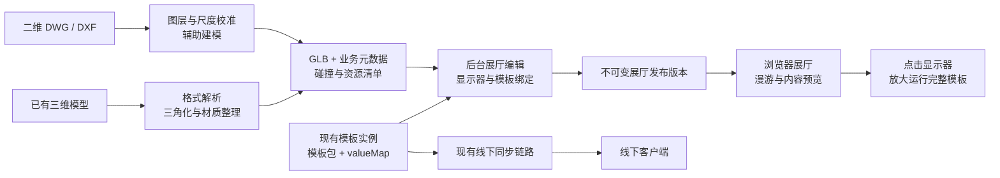

# 线上线下虚拟展厅模块设计草案

日期：2026-09-30。版本：v0.3。状态：用户已认可本方案，进入分阶段任务规划；尚未实现业务功能。

> 历史设计基线。第一阶段线上基础已实现；2026-09-30 用户要求重新核对管理端与现场网关/客户端，并确认保留访客内软件联动。当前事实与修订建议见 [跨项目架构核对](C:/Users/Administrator/Desktop/auto-exhibition-template-sdk/docs/superpowers/specs/2026-09-30-virtual-showroom-cross-project-review.md)。本文原有“单活动 runtime、跨屏联动不纳入首期”等范围不能继续作为完整线上线下交互的结论。

## 1. 用户目标与已确认范围

在现有展厅系统增加虚拟展厅模块，把实体展厅的空间、设备和内容呈现到浏览器中。管理员导入 CAD 或三维模型，补充空间与展项信息，将虚拟显示器绑定平台模板；访客在线逛展厅，点击显示器后使用完整模板。

用户已确认：

1. 二维 CAD 和已有三维模型两种数据都需要支持。
2. 第一阶段线上使用线下同一套模板与配置，每位访客独立操作，不影响线下设备。
3. 展厅内显示内容预览，点击显示器后放大操作完整模板。
4. 主要通过电脑访问，最好兼容手机。设计以电脑完成完整体验为主，手机支持基础三维参观、热点和模板入口；手机兼容的实测范围在终端样本确认后固定。
5. 已发布展厅打开链接即可参观，不要求访客登录；编辑需要登录并具备对应权限。
6. 线下模板内容更新后，后台提示有更新，由管理员预览后重新发布线上展厅。
7. 第一版准确还原空间与展项，适当优化材质和灯光；不以照片级效果作为验收目标。
8. 目前无法确定具体来源格式，先按主流格式规划支持范围，不等待用户先确定文件后缀。
9. 开发按阶段推进；相关测试暂由用户手动进行，不新增或运行自动化功能测试。保留构建/编译检查、产品本身的输入与发布校验，并逐阶段交付手测清单。

这些选择决定了首期架构：空间渲染和模板运行分开；内容版本共享，访客状态隔离；显示器先用预览纹理展示，完整交互交给独立模板容器。

格式范围采用第 5.4 节的默认分级方案；后续真实样本用于校准兼容版本、图层规范和性能，不再把“先确定来源格式”作为继续设计的前置条件。实际展厅和终端规模仍需在实施验证时校准。

## 2. 现有项目可以复用什么

本轮读取了 SDK 仓库、两个快捷方式指向的管理平台/客户端项目，以及用户提供的 demo。项目文档作为现状参考，不将其中的实施要求替代用户本轮请求；未读取线上数据库或修改运行中的系统。

| 项目 | 已观察到的能力 | 新模块的接入位置 |
| --- | --- | --- |
| `auto-exhibition-template-sdk` | Vue3 模板配置、`config.json`、`valueMap`、函数 manifest、模板函数与事件 API | 增加浏览器宿主通信适配及模板能力声明，保持现有模板取值机制 |
| `mju-smart-show` | Vue3/Element Plus 后台、Java/RuoYi 展厅业务、设备/主题/模板实例、文件服务 | 新增虚拟展厅管理、模型任务、屏幕绑定和发布接口 |
| `automatic_exhibition_setup_platform` | Electron 客户端/网关、模板下载与同步、本地 Bridge | 继续消费现有模板实例；后续可复用展厅发布包做本地演示 |
| 本地虚拟展厅 demo | Three.js 漫游、拾取、设备/墙体 JSON、鹰眼图、GLB 加载、内容面板 | 借鉴交互与配置结构，重新接入平台业务和可靠导入流程 |

现有模板实例包含 `templateId`、实例版本、ZIP 下载地址、MD5。实体中的 `valueMap` 注释仍称其为非落库字段，但本轮复核发现 `TemplateInstanceMapper.xml` 已读写 `value_map`，升级 SQL 也包含该列；未检查实际部署数据库。新模块以已发布实例 ZIP 中的 valueMap 为内容快照的可信来源，数据库字段可用于缓存/回填，不据过时注释推定其不存在。

现有 `DeviceThemeConfig` 使用 `deviceId + themeId + currentTemplateInstanceId` 表达线下内容。虚拟屏幕应能通过这条关系选择内容，也应能独立选择已有模板实例，不强制新增一台真实设备。

关键本地证据：

- [SDK 项目定位](C:/Users/Administrator/Desktop/auto-exhibition-template-sdk/PROJECT_UNDERSTANDING.md)
- [模板运行配置加载](C:/Users/Administrator/Desktop/auto-exhibition-template-sdk/src/runtime/context/createTemplateContext.ts)
- [SDK 默认本地 Bridge](C:/Users/Administrator/Desktop/auto-exhibition-template-sdk/src/runtime/communication/localBridgeTransport.ts)
- [模板实例实体](C:/Users/Administrator/Desktop/mju-smart-show/ruoyi-modules/mju-showroom/src/main/java/com/mju/showroom/domain/TemplateInstance.java)
- [设备主题关联](C:/Users/Administrator/Desktop/mju-smart-show/ruoyi-modules/mju-showroom/src/main/java/com/mju/showroom/domain/DeviceThemeConfig.java)
- [后台模板预览运行机制](C:/Users/Administrator/Desktop/mju-smart-show/ruoyi-ui-vue3/src/components/TemplateAnalysis/js/runtime.js)

后台目前已有 Service Worker/Cache 模板预览和本地 WebSocket 模拟桥。这证明浏览器运行既有模板有可复用基础，但它服务于管理预览；公开访客运行应使用发布后的静态实例产物和单独的宿主通信协议，避免依赖管理员缓存与权限。

## 3. Demo 与参考项目的判断

### 3.1 用户提供的 demo

可借鉴第一人称漫游、点击/靠近设备、设备标签、基础碰撞、鹰眼地图、JSON 配置和 GLB 加载。

它的三维屏幕目前使用 CanvasTexture 展示标题和摘要；完整 iframe/图片/视频在旁边的 DOM 面板显示。与本轮选定的交互方向相近，但仍需把“内容 URL”升级为“平台模板实例绑定”，并生成对应模板的真实预览。

CAD 转换是自写的 DXF 原型，未提供 DWG 解析，也没有图层/块的业务映射。本轮只读复现时，自带 DXF 示例在圆实体解析处报错；旧 POLYLINE 也存在丢失问题。导入 GLB 后还没有生成与模型相符的行走碰撞。应借鉴思路，不以该解析器作为生产转换基础。

证据：[场景与屏幕纹理](C:/Users/Administrator/Desktop/虚拟展厅/public/js/sceneBuilder.js)、[漫游及内容面板](C:/Users/Administrator/Desktop/虚拟展厅/public/js/viewer.js)、[DXF 转换原型](C:/Users/Administrator/Desktop/虚拟展厅/public/js/dxfConverter.js)。

### 3.2 网络项目

| 项目 | 核验到的定位 | 本项目中的建议 |
| --- | --- | --- |
| [ThreeUI](https://github.com/MengTo/threeui) | React/Three.js 交互组件、视觉特效与模板目录；公开 Community 源码为 MIT | 参考入口视觉和转场，不作为 CAD 转换或展厅编辑引擎；现有后台是 Vue，不能直接替换 |
| [Astral3D](https://github.com/mlt131220/Astral3D) | Vue3/Three.js 场景编辑器与 SDK，含资源、场景、HTML 面板和 CAD/BIM 展示机制 | 作为完整编辑器的备选，先核清授权和集成成本；本轮 Gitee 获取失败，依据作者 GitHub，未确认两端完全同步 |
| [Three.js 官方编辑器](https://threejs.org/editor/) | 浏览器场景编辑基础，支持项目与模型导出 | 借鉴对象树、变换、材质与撤销机制，围绕本系统制作轻量编辑器；[源码许可为 MIT](https://github.com/mrdoob/three.js/blob/dev/LICENSE) |
| [Babylon.js Editor](https://github.com/BabylonJS/Editor) | 基于 Babylon.js 的桌面场景制作工具 | 可作为专业人员离线制作模型的替代；首期不同时引入两套运行引擎 |

Astral3D 的 LICENSE 标为 Apache-2.0，但 [LEGAL.md](https://github.com/mlt131220/Astral3D/blob/main/LEGAL.md) 同时提出商业使用需作者书面授权等附加要求。本文不据许可证徽标认定直接商用范围；采用前应取得明确授权。

其 [HtmlPanel 源码](https://github.com/mlt131220/Astral3D/blob/main/packages/sdk/lib/core/objects/HtmlPanel.ts) 确实包含 HTML/ZIP 到 CSS3D 面板的能力，但默认样式限制交互，不能据此承诺既有模板直接嵌入即可完整操作。用户已选择“预览＋点击放大”，首期不需要依赖这项能力。

### 3.3 三种架构路线

| 路线 | 优点 | 主要成本 | 判断 |
| --- | --- | --- | --- |
| A. Vue3 + Three.js 轻量编辑器/查看器 + 独立 CAD Worker | 贴合现有后台与 demo；模板绑定和发布逻辑可控；可逐步扩充 | 需实现展厅相关编辑操作与格式适配 | **推荐** |
| B. 授权后的 Astral3D 编辑器 + 平台模板/发布适配 | 编辑能力更完整，可减少部分通用编辑开发 | 授权、SDK 边界、场景格式、升级和模板集成需验证 | 编辑需求较重时评估 |
| C. 商业 CAD/BIM 平台承担工程查看 | 多格式与大型工程模型路线成熟 | 云服务/许可成本、另一套查看器、展厅交互与模板嵌入适配 | 有复杂工程模型需求时作为专用入口 |

推荐 A 是基于本项目技术栈和已确认体验作出的设计判断，不是对参考项目所有功能完成实测后的结论。

## 4. 模块结构与数据流



职责划分：

- **管理后台**：展厅列表、模型导入任务、空间校准、设备/热点编辑、模板实例选择、预览及发布。
- **展厅运行器**：加载发布版本，渲染空间，处理漫游、碰撞、热点、预览和模板容器；查看器不加载编辑器全部代码。
- **CAD 转换 Worker**：解析原始文件、生成与优化模型、输出报告。Java 业务接口只派发任务与保存结果，大文件处理不占用请求线程。
- **模板宿主**：加载模板发布产物，建立通信与会话，提供访客独立的函数/事件路由。
- **现有 SDK**：继续提供模板配置和函数 API，只增加宿主适配与兼容声明。Three.js、CAD 解析器和完整编辑器不打包进通用模板 SDK。

后端业务优先扩展 `mju-showroom`；文件资源复用现有文件服务，代码中已有本地与 MinIO 实现，实际使用哪种存储需按部署确认。转换 Worker 可独立部署，与业务模块通过任务记录及作业队列交接，不要求首期拆出一组新微服务。

### 4.1 场景数据分三层

| 层 | 保存内容 | 编辑与替换规则 |
| --- | --- | --- |
| 建筑层 | 模型版本、模型到展厅的坐标变换、墙/地面/柱/装饰与材质映射 | 重导生成新模型版本，不覆盖现有业务展项 |
| 展项层 | 平台对象 ID、显示器/展台/热点、锚点或自由位置、内容绑定 | 由平台维护，独立于 CAD 网格；复制展项生成新 ID |
| 导航层 | 入口、预设视点、可行走区域、简化碰撞数据 | 建筑替换后复核；不用完整装饰网格直接做碰撞 |

管理员可以在任何合适位置放置虚拟显示器，不要求 CAD 已含显示器。已有显示器外壳可保留在建筑模型中，在屏幕位置附加可配置的内容平面；模型已有展项也可映射到平台业务对象。这样模型精简或替换后，显示器和模板关系仍由平台维护。

锚点保存 `modelFamilyId + sourceEntityId + anchorLocalTransform`，人工调整保存额外偏移。世界位置由建筑变换、锚点变换与人工偏移组合得到；自由放置对象直接保存展厅局部变换。没有持久源实体标识的输入，不承诺自动匹配所有对象。

模型重导输出“唯一匹配、新增、缺失、歧义”列表。唯一可信匹配可迁移锚点；名称或几何邻近只作为人工确认建议。缺失锚点保留业务对象与旧位置，并标为需处理，不直接删除屏幕或绑定。

## 5. CAD 双入口

### 5.1 二维 CAD：辅助建模

二维平面图描述轮廓和尺寸，通常不包含完整墙高、材质、设备外观和空间语义。处理流程是“解析＋规则建模＋人工补齐”，不是任意图纸一键还原完整展厅。

1. 检查文件内容，识别二维/三维/混合实体、单位、图层、块与外部引用。
2. 二维 DWG 经选定适配器转换/解析；DXF 进入二维解析器。缺失字体或外部引用产生报告，保留未处理实体信息。
3. 操作者确认单位与一条已知尺寸，再映射墙体、门窗、柱、设备和应忽略的标注图层。明确墙线是中心线还是边界轮廓。
4. 输入墙高、墙厚、标高及门洞参数；对闭合轮廓生成地板/墙体，对块映射已有展台、显示器和柜体资产。
5. 对开口、重叠、非闭合轮廓和缺失块给出定位提示，支持人工纠正；不要把所有线段无差别拉成墙。
6. 预览比例、门洞、屏幕方向和行走范围，审核后生成标准模型。

可评估 [dxf-parser](https://github.com/gdsestimating/dxf-parser)：官方支持多数二维实体、图层、块/INSERT，但明确不支持 3DSolids。引入后仍需覆盖本项目用到的实体、bulge/曲线和异常样本验证。

[ODA File Converter](https://www.opendesign.com/guestfiles/oda_file_converter?language=en) 可做 DWG/DXF 与版本转换，不能把二维图纸补成三维空间。其自动化部署与使用条件需要按所选版本确认；DWG 接入封装为可替换适配器。

### 5.2 已有三维模型：格式转换与优化

| 输入 | 建议路径 | 必须说明的边界 |
| --- | --- | --- |
| GLB/glTF 2.0 | 校验、坐标规范化、资源归集、优化后导入 | 外部贴图/缓冲区完整性、必须扩展与解码器；业务对象不能被优化合并丢失 |
| STEP/IGES/BREP | OCCT 系列解析/三角化，导出 GLB | 几何与颜色不等于完整展示材质、UV、纹理与灯光 |
| 三维 DWG | ODA Drawings 等商业适配器解析，再构建 GLB | 不由 DXF 二维解析器或 occt-import-js 直接处理；需实际实体样本验证 |
| IFC | 单独 BIM 适配器解析几何、楼层及业务元数据，再组装 GLB | 不由 STEP 入口直接处理，也不把 IFC 解析或其他中间产物当作完整 GLB 转换 |
| OBJ/FBX/STL | 对应网格解析器加载，规范化材质/坐标并输出 GLB | 各格式的材质、单位、层级和版本能力不同，见第 5.4 节 |

[occt-import-js](https://github.com/kovacsv/occt-import-js) 支持 BREP/STEP/IGES，可输出模型层级、网格、颜色并设置输出单位和三角化精度；它没有 DWG/DXF 导入能力。服务器 Worker 可采用原生 OCCT 导出，或将该工具输出的网格与树组装成 GLB；需补材质映射。

[ODA Drawings SDK](https://www.opendesign.com/products/drawings) 官方列有 DWG/DXF 处理及多种导出，不能由此推定直接提供符合本业务元数据要求的 GLB。适配层仍要负责标准产物和对象映射。

[Autodesk APS Model Derivative](https://aps.autodesk.com/model-derivative-api-2d-3d-conversions) 的主要浏览链路是 SVF/SVF2 与 Autodesk Viewer，本文只将其列为工程格式兼容备选，不当作已验证的通用 GLB 转换服务。

二维/三维按内容识别，而不是只按扩展名分类；一个 DWG 可能包含混合内容，导入时由操作者选择展厅来源。

### 5.3 统一产物

建议一个模型版本输出：

- `scene.glb`：可在浏览器展示的几何与材质。
- `scene.meta.json`：源版本、转换器版本、单位、原点变换、对象标识、屏幕/热点/碰撞锚点、图层映射。
- `assets.manifest.json`：资源路径、内容摘要、大小、MIME 与依赖关系。
- 缩略图、转换报告；场景较大时输出按区域拆分的模型。

统一米制、Y 轴向上，保留 CAD 原始坐标和转换矩阵；大坐标转换到展厅局部坐标，避免浏览器精度问题。[glTF 规范](https://registry.khronos.org/glTF/specs/2.0/glTF-2.0.html) 规定线性单位为米，节点名称不保证唯一。

平台生成持久 `objectId/screenId`，放入业务元数据及可行时的 GLB `extras`。屏幕绑定不依赖模型文件名、网格索引或自动生成名称。模型替换时优先按源实体标识匹配；未匹配项进入“需重新绑定”列表，由管理员确认。

建筑网格可以减面、材质复用及压缩；屏幕面、热点、碰撞和导航锚点保留独立标识。优化前后校验对象标识、数量、变换及屏幕 UV；碰撞数据独立生成和审核，不能仅加载模型就声称可以可靠漫游。

转换器按各自许可部署：[occt-import-js](https://github.com/kovacsv/occt-import-js/blob/main/package.json) 标注 LGPL-2.1，不能把整条转换链默认认作 MIT；商业 DWG 适配器需包含对应自动化/Web 部署授权。具体组件与版本在实施选型时固定。

### 5.4 主流格式支持矩阵

以下是建议的开发交付范围，不是本系统当前已具备的导入能力。一期完整目标包含通用网格入口与二维/三维标准 CAD 入口；扩展格式独立验收和启用。前端只展示部署中已通过验收的能力。

| 格式 | 默认优先级 | 用户提交方式 | 主要支持内容与边界 |
| --- | --- | --- | --- |
| `.glb` / `.gltf` | 一期核心，推荐交付格式 | GLB 文件或 glTF 主文件＋buffer/贴图包 | glTF 2.0 几何、标准材质与节点；检查外部依赖与扩展。GLB 也应检查是否存在外链纹理，不能只按后缀认作完全自包含 |
| `.obj` | 一期核心 | OBJ＋MTL＋贴图，建议 ZIP 保留相对目录 | 展厅/展项几何、基础材质映射；缺失 MTL/贴图时提示并允许明确选择占位材质；单位由用户确认 |
| `.fbx` | 一期核心，受限导入 | FBX＋外部贴图包（如有） | 展示用静态几何、节点、基础材质映射；官方 Loader 的最低入口为 ASCII 7.0 / Binary 6400，平台实际启用版本仍需验证；专有材质、动画和复杂变形不承诺完全还原 |
| `.stl` | 一期补充，适合展品零件 | 单文件；确认单位和尺寸 | 静态三角网格；不依赖非标准颜色扩展，不承诺纹理、结构层级或可自动识别的显示器对象 |
| `.dxf` | 一期 CAD 入口 | DXF＋必要的外部依赖包 | 二维图层/块/轮廓与辅助建模；不把三维实体混同于二维规则。ASCII 入口优先，Binary DXF 是否启用以解析器验证为准 |
| `.step` / `.stp` | 一期 CAD 入口 | 文件及转换器能够处理的配套引用 | 已有三维几何、装配/节点和颜色尽力保留；纹理/UV 与展示材质需要整理，不提供参数化 CAD 编辑 |
| `.iges` / `.igs` | 一期 CAD 入口 | 单文件或必要引用包 | 曲面/几何三角化；层级和材料完整性按输入验证；不保证破损曲面自动修复为可制造实体 |
| 二维 `.dwg` | 重点扩展 | 授权且已部署的 DWG 适配器启用后可直接上传；此前在原软件导出 DXF | 直接 DWG 导入必须独立验收。导出 DXF 是明确的兼容路径，不计作平台已支持直接 DWG |
| `.ifc` | 重点扩展 | IFC 文件；预检 schema 与单位/地理坐标 | 首批扩展以 IFC2x3/IFC4 为目标；几何、楼层、构件标识/属性保留在 GLB＋元数据中；完整 IFC 导出/编辑不在范围 |
| 三维 `.dwg` | 后续专用适配 | 商业/专用解析器；或原工具导出可支持的三维格式 | 单独处理三维实体、代理对象及引用，不依赖二维 DXF 解析流程；不能只启用二维 DWG 转换就宣称三维 DWG 可用 |
| `.max` / `.skp` / `.rvt` / `.sldprt` 等原生文件 | 首期仅给出原工具导出指导 | 从制作软件导出 FBX/OBJ/glTF、IFC 或 STEP 等已启用格式 | 不列为直接上传支持。具体可导出格式取决于软件版本和导出插件，不承诺每种软件都具备同一导出菜单 |

一期的格式范围优先服务“整厅空间＋展示资产”，场景动画导入不是首期核心验收。用户可保留原始文件用于未来转换，但不能把未启用格式直接送进现有 Worker 并显示转换成功。

技术依据：Three.js 提供 [OBJLoader](https://threejs.org/docs/pages/OBJLoader.html)、[FBXLoader](https://github.com/mrdoob/three.js/blob/dev/examples/jsm/loaders/FBXLoader.js) 与 [STLLoader](https://github.com/mrdoob/three.js/blob/dev/examples/jsm/loaders/STLLoader.js)。这些是可选解析基础，仍需平台完成依赖归集、材质规范化、GLB 输出和实际样本验证。STEP/IGES 走 OCCT 路线。IFC 可评估 [web-ifc](https://github.com/ThatOpen/engine_web-ifc)，其许可为 MPL-2.0；不自动替换成一套 BIM 查看器或新的运行文件格式。

OBJ 的 MTL 载入通常生成传统材质，FBX 也有分层贴图、动画与变形的支持缺口；转 GLB 前应做材质映射并生成报告。[GLTFExporter](https://github.com/mrdoob/three.js/blob/dev/examples/jsm/exporters/GLTFExporter.js) 不支持任意 ShaderMaterial，动画也需显式选择；不能把“存在 loader 和 exporter”当作无损转换证明。一期只验收静态场景与展项，不在格式支持标签中承诺全部源动画。

IFC 扩展首批目标为 IFC2x3/IFC4；IFC4x3 ADD2 作为单独条件支持，其他 RC/旧别名版本按锁定转换器能力报告，不归入“全部 IFC4x3 可用”。[web-ifc 官方源码](https://github.com/ThatOpen/engine_web-ifc/blob/main/src/ts/web-ifc-api.ts) 提供几何、GlobalId/expressID 等接口，平台还需自行生成 GLB 并保存楼层、构件、属性和对象关联。IfcImporter 等工具的其他中间格式不直接替换本方案的 GLB 契约。

对 IFC 保留源单位、楼层原始标高、构件放置、CRS/MapConversion 和原点偏移。模型移到局部原点只是坐标规范化，不等于完整地图投影；[buildingSMART 的 IfcMapConversion](https://standards.buildingsmart.org/IFC/RELEASE/IFC4_3/HTML/lexical/IfcMapConversion.htm) 本身也不执行地图投影。多模型导入同一展厅应共用坐标基准，不各自居中后丢失相对位置。

### 5.5 文件与依赖包约定

上传支持单文件和 ZIP 资源包。ZIP 是资源容器，不是新增模型格式；预检枚举主文件，多个主文件由用户选择入口，保留相对目录，不按第一个后缀盲选。

常见包结构：glTF 包包含 `.gltf`、`.bin` 和贴图；OBJ 包包含 `.obj`、`.mtl` 和贴图；FBX 若依赖外部贴图，也一并打包。JPEG/PNG/WebP 作为首期常用贴图目标，其他纹理编码按已启用解码器处理。

文件缺失、重复路径、大小写不一致和无效引用进入导入报告。转换器只读取上传包及平台明确选择的资源；不自动抓取文件中任意远程 URL 或读取服务器绝对路径。嵌入文件与压缩包解包遵守目录边界和资源限制。无法补齐的非必要材质可由用户选择占位；缺少必要几何/缓冲区则阻断转换。

`.glb/.gltf` 发布前可引入 [Khronos glTF-Validator](https://github.com/KhronosGroup/glTF-Validator) 检查标准与资源错误。标准校验通过之后，还要验证平台已启用扩展/解码器、坐标、业务标识、碰撞和性能；不能仅以“是有效 glTF”认定展厅可发布。

### 5.6 导入向导

1. **上传与识别**：用户无需预先选择技术格式；系统按文件签名/内容和扩展名识别，展示二维图纸、三维 CAD、BIM 或通用模型。冲突/混合内容要求确认，不静默猜测。
2. **选择用途**：导入整厅建筑、独立展项资产，或二维图纸生成空间。整厅导入默认新建/替换建筑层，独立资产加入资源库；不把新建筑叠加在 demo 默认房间中。
3. **补齐依赖与校准**：展示缺失文件；确认单位、朝向、参考尺寸；二维入口增加墙高、墙厚、图层/块映射。IFC 扩展增加楼层/构件过滤和地理坐标转换。
4. **预检与转换**：统计节点、三角形、材质、贴图、模型尺寸与预估资源量；用户选择适合电脑/手机的质量档。后台转换，页面可离开后在任务列表继续查看。
5. **结果复核**：对照尺寸、材质、缺失对象和变换，查看转换/优化报告；重新导入时核对旧锚点匹配；确认后作为新模型版本加入草稿。
6. **完成空间配置**：设置行走碰撞、入口、展项/显示器与模板绑定，再进行电脑/手机预览和发布检查。转换完成不自动上线。

不支持或未启用的格式给出可执行的说明，例如“当前可将二维 DWG 从原软件导出为 DXF 后导入”；保留任务识别结果，不显示虚假的解析进度。

### 5.7 转换适配器与能力发现

所有适配器遵循同一设计契约：`probe → dependencies → parse/build → normalize → optimize → validate → artifacts`。单独版本化解析器和参数；业务层只消费统一 GLB、元数据、导航/碰撞产物及报告。

能力记录至少包含 `format`、已验收的版本/实体范围、部署状态、解析器版本、单位/材质/层级/源标识保留能力，以及文件/资源预算。部署状态区分“已启用”“需部署转换器”“试验性”“不支持”，不以文件选择框的 accept 列表充当支持证明。

拟增加登录可见的能力接口 `GET /showroom/virtual/admin/import-capabilities`，导入向导据此显示入口；公开访客不需要了解转换器详情。网格适配器、二维建模适配器、三维 CAD 适配器和 BIM 适配器可以独立更换，不修改展厅 viewer 或模板 SDK。

结果报告记录输入摘要、格式/版本、单位与坐标确认、源标识可信度、材质映射、未支持实体、丢失/降级项、三角形与资源大小、输出摘要及解码器依赖。源实体标识仅在输入可靠时作为重导匹配依据，转换器生成的网格编号不升级为持久标识。

任务结果区分：格式不支持、转换器未部署、源版本不支持、依赖缺失、需确认单位、无有效几何、实体部分不支持、资源超过预算、转换失败。界面按这些结果给出补文件、校准、选择占位材质、从原软件导出或稍后重试的操作；部分成功必须显示丢失范围，不能与完整成功使用同一状态。

大文件在隔离的服务端作业处理，浏览器负责预检界面、参数确认和结果预览。网格解析/导出若依赖 DOM/Image 等浏览器环境，可使用独立受控转换环境；CAD/BIM 的 WASM 或原生解析器独立接入，不能假定所有 Three.js Loader 直接在 Java/纯 Node 请求线程中运行。

### 5.8 格式验收样本计划

在真实来源未定时，先规划每类公开或自建的正常与异常样本，作为用户手动验收材料；按用户最新要求，现阶段不新增/运行自动化功能测试。本轮未实际执行这些转换验收。

| 类别 | 至少需要验证的样本/行为 |
| --- | --- |
| GLB/glTF 2.0 | 嵌入/外部资源、多节点/多场景、常用 PBR、已启用压缩、必要扩展不支持、损坏/缺失 buffer；多场景明确选择导入入口 |
| OBJ | 完整 MTL/贴图包、缺失贴图、相对路径/大小写、单位校准及材质降级确认 |
| FBX | 已声明版本的 ASCII/Binary、内嵌/外部贴图、节点变换与单位、专有材质警告；静态结果与动画支持范围分别声明 |
| STL | ASCII/Binary、单位未知、已知尺寸校准、法线/空网格及不依赖颜色扩展 |
| DXF | 图层、块/INSERT、多段线/圆弧、单位未知、轮廓开口、二维/三维混合、外部引用、未支持实体定位 |
| STEP/IGES | 毫米/米、装配/曲面、颜色、失败三角化、源节点与坐标映射；不能由网格序号推定跨版本稳定 |
| DWG 扩展 | 与 DXF 路线对照；二维/三维分别验证；转换器缺失、代理对象、外部引用和真实支持版本明确反馈 |
| IFC 扩展 | 按 schema 验证楼层/构件、GlobalId/属性、单位及地理坐标；元数据与 GLB 对象关联不丢失 |

各适配器只有完成构建及用户确认的格式样本、标准产物、业务绑定保留和浏览器加载手动验收后才标为“已启用”。性能基线再以典型展厅校准，不拿小型公开模型代替实际规模验证。导入/发布时执行的程序校验属于产品功能，仍需实现，不因暂缓自动化测试而省略。

## 6. 后台业务流程

建议在现有“展厅管理”中增加“虚拟展厅”，下设展厅列表、模型资源和导入任务；不必先创建独立后台。

管理员流程：

1. 新建展厅，填写名称、封面、内容归属与主题。
2. 上传模型或 CAD，查看识别结果与转换任务；二维文件完成图层和高度校准。
3. 进入编辑器，设置模型方向、入口、墙体/碰撞、预设视点及热点。
4. 选择显示器对象，配置横竖屏、内容比例与预览方式。
5. 绑定已有模板实例，或从“真实设备＋主题”的当前实例解析内容。
6. 浏览器预览漫游和模板，处理导入警告及内容不兼容项。
7. 发布一个展厅版本，生成访问链接/二维码；后续更改保存在草稿，重新发布才切换线上版本。

轻量编辑器首期需要对象树、点选、移动/旋转/缩放、数值输入、复制/删除、吸附、撤销/重做、屏幕锚点和热点配置。建模细节仍交给 CAD/三维工具，不扩成通用设计软件。

### 6.1 核心页面

| 页面 | 主要内容与操作 | 入口权限 |
| --- | --- | --- |
| 展厅列表 | 封面、名称、当前发布版本、草稿修改标记、内容更新提示；新建、编辑、参观、分享、下架 | 登录＋列表/对应操作权限＋本人归属 |
| 导入任务与校准 | 文件识别、单位/已知尺寸、图层/块映射、高度参数、转换报告与预览 | 登录＋导入权限＋任务/资产归属 |
| 展厅编辑器 | 左侧建筑/展项树，中间三维画布，右侧空间/内容/预览属性；顶部保存、电脑/手机预览、发布 | 登录＋编辑权限＋展厅归属；发布另外授权 |
| 公开参观页 | 展厅标题、空间、展项列表/热点、操作帮助、模板放大容器 | 有效公开链接；无需登录 |

发布检查、版本历史和内容更新对照以编辑器内面板承载，首期不再增加一套独立审批后台。

### 6.2 显示器属性

显示器至少保存：`screenId`、名称、启用状态、锚点引用/自由位置、位置/四元数/缩放、实际宽高（米）、显示正面、模板原始比例、`fitMode`、内容绑定和预览引用。

默认 `fitMode=contain`，保持模板比例，显示器比例不同则留边；不得自动拉伸文本。编辑器直接展示留边效果。选择模板实例时显示模板名、实例版本、来源设备/主题（如有）、横竖屏与浏览器/手机兼容结果。

普通热点至少支持文字/图片说明与跳转预设视点；与显示器复用空间选择方式，但不强制建立模板实例。

### 6.3 首期视觉标准

空间比例、主要墙体/门洞、显示器和关键展项位置优先准确。材质采用一套可复用的地面、墙面、金属、玻璃及显示器预览方案，灯光适当优化，优先静态效果与有限实时灯光。导入后仍需人工检查位置、正面、材质和行走区域，不把 CAD 几何转换作为最终展示验收。

对齐真实展厅时按一条或多条已知尺寸校验尺度，再核对关键展项；具体允许误差根据原图精度和真实样本确定。图纸未提供的装饰细节不作自动补齐承诺。

## 7. 显示器与模板实例绑定

核心关系：`screenId → contentBinding → templateInstanceId + version + artifactHash`。

绑定来源提供两个业务选项：

- **从线下设备选择**：选择已有设备/主题配置，解析当前已发布模板实例，显示实例版本；不关联设备控制权限。
- **直接选择模板实例**：适合新增线上屏幕或没有真实硬件的展项，复用既有配置能力。

首期上述两种来源都只选择已有的已发布实例。展厅发布只创建展厅 revision 和资源引用，不调用现有 `DeviceThemeConfigServiceImpl.publishConfig`；该方法必须依赖真实设备主题配置，且会回写线下当前实例。管理员在虚拟展厅里更换绑定，不修改实例内容。

若后续需要给纯线上展项新建或单独修改配置，应复用现有配置表单与模板产物生成能力，另设不回写线下设备关系的内容实例入口；不为了生成内容伪造真实设备。本轮暂不把这个扩展当作已有能力或首期必做范围。

用户已确认采用发布时冻结实例版本。管理员更新线下内容后，后台提示关联虚拟展厅有可更新内容；管理员预览并重新发布。这样线上线下复用同一内容来源，同时能说明每个展厅版本实际使用了哪份配置。

内容更新提示按绑定来源处理：`device-theme-instance` 保存 `sourceConfigId`，比较该设备主题配置当前已发布实例与屏幕固定版本；`direct-instance` 固定所选实例，只在管理员手动改选时更新。直接绑定若未来需要新版提示，必须另定义稳定内容源/实例族，不能只按 `templateId` 比较不同设备的配置。管理员可逐屏选择“保持旧版”或“更新到新版”，再重新生成预览和发布资源；不自动改变已发布展厅。取消或校验失败保留旧内容。展厅发布成功后，新访客进入新版，正在参观的会话保持进入时版本。

自动跟随内容不属于本轮确定的更新策略，不为其增加即时同步和网关控制链路。

不要为每个线上访客写入真实 `device_info`，不要复制一套模板商品/审核/配置系统。复用模板资产与实例；访客仅产生短期会话和本地交互状态。

## 8. 访客体验与模板运行

### 8.1 已确认的首期显示方式

进入展厅后看到空间和各显示器的内容预览。预览默认使用从绑定实例生成的截图/封面纹理，不只是设备名称；视频展项可选择受控的视频预览。点击显示器后，镜头可轻微聚焦，随后打开放大的模板容器；关闭后回到原位置与视角。

完整模板通过 iframe 运行，使用其原始横竖屏比例和配置。桌面键鼠漫游在操作模板时暂停，退出恢复；手机采用触控视角、热点/预设视点跳转和较轻的资源版本，不依赖 Pointer Lock。模板按比例缩放并保留退出控件，固定大屏模板单独验证手机点击目标与可读性，不能仅缩小页面就认定兼容。只让正在操作的模板常驻运行，远处屏幕使用预览，避免每台虚拟屏都加载完整应用。后台 CAD 校准与场景编辑以电脑使用为主，手机兼容范围面向参观端。

预览由浏览器截图作业或模板提供的封面生成，作业使用与正式访客相同的浏览器宿主模式；硬件依赖不会在截图时执行。若模板不可截图，管理员选择封面并看到提示。预览图与模板版本一起发布，避免内容不一致。

Three.js 的 [VideoTexture](https://threejs.org/docs/pages/VideoTexture.html) 可用于模型上的视频显示；网页 iframe 不是普通 WebGL 纹理。未来若做直接在三维屏幕表面操作网页，再评估 CSS3D 的遮挡、输入和缩放边界。[CSS3DRenderer 官方文档](https://threejs.org/docs/pages/CSS3DRenderer.html) 列出相关限制；本轮选定体验无需首期引入这一复杂度。

### 8.2 浏览器宿主通信

当前 SDK 默认 `ws://127.0.0.1:5176`，面向本地客户端。线上采用新的浏览器宿主 transport，通过 `postMessage/MessageChannel` 与展厅模板容器通信，保留函数 API 的业务含义。

当前内部 `RuntimeTemplateBridge` 已抽象 transport，但公开 SDK 默认单例没有宿主注入选项。设计建议增加可选初始化项，注入浏览器 transport；现有本地模板保持默认行为。该 API 尚未实现，实施时应检查初始化顺序和兼容性。

每个屏幕运行实例拥有独立的 `visitorSessionId + screenId + runtimeId`。即使相同模板同时出现在多个屏幕，也不共用页面全局单例。首期只对已启动的活动 runtime 执行函数，未启动目标返回 `TARGET_NOT_ACTIVE`；跨屏函数联动不属于首期必做范围，不能为兼容它而隐含启动全部模板。真实设备目标返回浏览器模式不可用；线上宿主不连接实体网关。

消息校验包括来源 origin、对应 iframe 的 `source`、会话/运行实例标识和函数白名单；关闭模板后销毁通信与定时器。登记调用等待项后再发送请求，确保新 transport 即时返回时不会丢失结果。

公开模板资源使用独立运行源承载，与管理后台隔离，不携带后台登录 token。当前 SDK 的配置预览消息只允许同源；跨源模式需通过明确宿主握手适配，不能直接放宽为任意来源。原始 `config.json/valueMap.json` 同级路径和子路径部署必须继续可用。[postMessage 官方说明](https://developer.mozilla.org/en-US/docs/Web/API/Window/postMessage) 要求校验来源并指定目标源；[frame-ancestors](https://developer.mozilla.org/en-US/docs/Web/HTTP/Reference/Headers/Content-Security-Policy/frame-ancestors) 控制可嵌入宿主。

模板容器的 sandbox 只授予已验证模板所需权限；独立运行源与后台不同源，默认不允许顶层导航、弹窗或任意表单提交。运行响应的 CSP `connect-src` 只允许发布资源及访客模式 API，不允许本地 Bridge、内网实体网关和设备控制端点；后端同时拒绝访客凭据修改线下配置。发布检查剔除包内设备凭据和控制依赖。这些约束同时覆盖模板直接使用 fetch/WebSocket 的路径，不能只限制 SDK 路由。

老模板可沿用后台现有的本地 WebSocket 模拟桥思路制作兼容加载器，但它是过渡适配，不把全局 WebSocket 改写作为新模板长期标准。

### 8.3 模板兼容与状态隔离

发布前检查模板是否依赖 Electron、本地磁盘、摄像头、硬件接口或只对内网开放的资源。兼容声明可采用“浏览器可运行／浏览器部分能力／仅本地设备”；只有经过浏览器验证的实例作为完整在线交互内容，部分能力给出降级说明。

相同模板与配置不意味着天然访客隔离。独立运行源只隔离管理后台，不会自动隔离该源下多个 iframe 的 localStorage、IndexedDB 和缓存。

首期浏览器兼容模板以运行内存保存临时状态；确需持久化时，通过宿主存储 API 使用 `visitorSessionId + screenId + runtimeId` 命名空间。未经适配的全局持久状态访问和根级 Service Worker 不能通过在线发布校验；默认运行策略禁用模板注册 Worker，需使用的模板另作兼容验证。无法适配的旧模板需采用真正独立的运行实例 origin 或暂以预览/降级形式上线，不能把不同 URL 路径当作存储隔离。共享只读资产缓存由宿主管理。

模板的后端业务接口也必须使用访客身份和会话状态范围；播放位置、选项和临时状态不能覆盖其他访客或线下配置。两个屏幕及两个标签页的隔离都应验证。

既有纯前端内容模板更容易迁移；访问共享后端写接口的模板需要访客模式适配。没有这些检查，无法仅靠 iframe 保证“各自操作、不影响线下”。

## 9. 公开访问、权限、数据与发布

### 9.1 访问与权限矩阵

登录是编辑的必要条件，不代表任意登录账号都可以编辑全部展厅。首期沿用本人归属范围，再检查每项操作权限；跨用户协作不是默认开启能力。

| 身份/条件 | 已发布展厅参观 | 草稿/原始 CAD/导入报告 | 修改场景/绑定 | 发布/下架/回滚 |
| --- | --- | --- | --- | --- |
| 匿名访客 | 有效链接即可 | 不可 | 不可 | 不可 |
| 已登录但无管理权限 | 与访客相同 | 不可 | 不可 | 不可 |
| 本人展厅＋编辑权限 | 可以 | 需对应查询/导入权限 | 场景需 edit；绑定另需 bind | 需 publish/offline/rollback 各自权限 |
| 本人展厅＋发布权限 | 可以 | 需对应查询权限 | 需 edit/bind 各自权限 | 发布可用；下架/回滚另需对应权限 |
| 有操作权限但非本人展厅 | 可公开参观 | 首期不开放 | 不可 | 不可 |

后台权限建议为 `showroom:virtualShowroom:list/query/add/edit/import/bind/publish/offline/rollback/remove`，与现有 `@RequiresPermissions` 接入。服务端创建记录时填入当前用户，列表、按 ID 查询、修改、删除、任务与资源选择都检查归属；不接受前端决定 `ownerUserId`。

首期展厅管理角色可以同时具备编辑与发布权限，不强制增加多人审批；将操作权限分开是为了明确服务端检查和后续角色配置。

现有 [DataOwnershipUtils](C:/Users/Administrator/Desktop/mju-smart-show/ruoyi-modules/mju-showroom/src/main/java/com/mju/showroom/utils/DataOwnershipUtils.java) 实际只判断本人归属，注释与管理员行为不一致。首期不据此假设超级管理员自动具有跨用户编辑能力；如确需跨用户管理，必须单独定义显式权限策略。

### 9.2 两套访问入口

公开页建议为独立轻量构建入口 `/v/{publicCode}`，不加载后台 Layout、菜单、用户信息及管理 API。管理列表/编辑页继续使用现有后台登录与动态路由。公开链接建议长期稳定，发布新版时保持同一链接；分享码只是定位已公开展厅，不是编辑凭据。

当前 [permission.js](C:/Users/Administrator/Desktop/mju-smart-show/ruoyi-ui-vue3/src/permission.js) 仅放行登录/注册，其他匿名访问会重定向登录。如果实施时仍使用同一 SPA，需要为参观页建立独立静态路由并精确放行参观路径；登录用户打开它时也不依赖用户菜单初始化。

公开端使用独立 HTTP 客户端，不自动携带 RuoYi Bearer token，不使用后台 401 弹出重新登录的流程。已登录管理员打开公开链接，也按公开访客运行模板；进入编辑器才使用管理身份。

### 9.3 数据对象与场景快照

建议的业务对象如下，字段与表名在设计定稿时细化：

| 对象 | 核心内容 |
| --- | --- |
| `virtual_showroom` | 名称、归属用户、关联主题、封面、稳定 publicCode、公开状态、当前发布版本 |
| `showroom_model_asset` | 原文件、格式、输出资源、单位、转换矩阵、摘要、版本与报告 |
| `model_import_job` | 输入、转换参数、阶段、进度、日志、失败原因与重试记录 |
| `showroom_revision` | 草稿版本号/发布状态、建筑/展项/导航 JSON、资源清单、模板快照引用、创建与发布时间 |
| `showroom_screen_binding` | 持久屏幕标识、绑定来源、模板实例/版本、比例、预览、兼容状态 |

屏幕绑定编辑记录入库，发布时拷入不可变 revision manifest。运行期不再次实时解析设备“当前模板”，避免发布后内容漂移。重模型和模板资源放文件存储，数据库只存元数据、JSON 与资源引用。

场景文档最小结构示例（字段为拟定协议，不是现有实现）：

```json
{
  "schemaVersion": 1,
  "draftVersion": 12,
  "building": {
    "modelVersionId": "model-v3",
    "modelToShowroom": {
      "position": [0, 0, 0],
      "quaternion": [0, 0, 0, 1],
      "scale": [1, 1, 1]
    }
  },
  "navigation": {
    "spawn": { "position": [0, 1.6, 4], "yaw": 0 },
    "collisionRef": "collision-v3",
    "viewpoints": []
  },
  "objects": [
    {
      "objectId": "screen-001",
      "type": "screen",
      "name": "序厅显示器",
      "anchorRef": null,
      "transform": {
        "position": [2, 1.5, 0],
        "quaternion": [0, 0, 0, 1],
        "scale": [1, 1, 1]
      },
      "widthM": 1.2,
      "heightM": 0.675,
      "fitMode": "contain",
      "enabled": true,
      "contentBinding": {
        "source": "device-theme-instance",
        "sourceConfigId": "31",
        "templateInstanceId": "208",
        "instanceVersion": 4,
        "artifactHash": "example-content-hash"
      },
      "previewRef": "screen-001-instance-208-preview"
    }
  ]
}
```

大整数数据库 ID 对外用字符串，避免浏览器数字精度丢失。此例以 `objectId` 作为显示器业务 ID（即 `screenId`），不再保存两份可独立修改的编号。草稿保存/发布由接口传递展厅 ID，发布 manifest 再加入 `revisionId` 与运行资源地址。

坐标协议采用米制、Y 向上、屏幕局部 +Z 为正面，旋转保存四元数；视点 yaw 使用弧度。附着锚点对象保存局部变换，自由放置对象保存展厅变换，必须显式区分，避免模型替换时重复应用坐标转换。

### 9.4 拟定接口边界

下列为外部访问路径建议，需在实施时按现有网关路由验证；不表示这些接口已存在。

| 操作 | 路径建议 | 访问条件 |
| --- | --- | --- |
| 打开已发布展厅 | `GET /showroom/virtual/public/{publicCode}/manifest` | 匿名；检查公开状态，返回当前发布版本的专用 DTO |
| 获取运行资源 | `GET /showroom/virtual/public/{publicCode}/resources/{assetKey}` | 匿名只读；校验发布清单/只读访问票据，解析实际资源 |
| 展厅列表/新建 | `GET/POST /showroom/virtual/admin/showrooms` | 登录＋对应权限；本人数据范围 |
| 获取草稿/保存 | `GET/PUT /showroom/virtual/admin/showrooms/{id}/draft` | 登录＋query/edit＋本人归属；保存检查 expectedDraftVersion |
| 创建/查询导入任务 | `POST/GET /showroom/virtual/admin/import-jobs` 及 `/{jobId}` | 登录＋import/query＋任务/资产归属 |
| 查询已启用导入能力 | `GET /showroom/virtual/admin/import-capabilities` | 登录＋import；返回本部署支持范围与预算，不返回资产/凭据 |
| 更新屏幕绑定 | `PUT /showroom/virtual/admin/showrooms/{id}/screens/{screenId}/binding` | 登录＋bind/edit＋本人归属；模板授权与实例状态检查 |
| 发布前校验 | `POST /showroom/virtual/admin/showrooms/{id}/validate` | 登录＋query/edit＋本人归属；校验固定草稿版本 |
| 发布/下架/回滚 | `POST /showroom/virtual/admin/showrooms/{id}/publish`、`/offline`、`/rollback` | 登录＋独立操作权限＋本人归属 |

公开命名空间只包含已定义的访客读取功能，不接收模型上传、场景编辑、设备配置或模板管理操作。manifest 不返回原 CAD、任务日志、后台用户字段、设备控制地址、原始模板 ZIP 下载地址或草稿对象；模板所需已发布网页文件属于公开运行资源。

现有 [AuthFilter](C:/Users/Administrator/Desktop/mju-smart-show/ruoyi-gateway/src/main/java/com/ruoyi/gateway/filter/AuthFilter.java) 根据 Nacos 白名单按路径提前放行，并不按 HTTP 方法区分。只配置专用公开前缀/精确读取路由，不能放行整个 `/showroom/**` 或 `/showroom/virtual/**`；管理接口保留网关认证和服务端操作权限检查。公开控制器仅实现 GET/HEAD 等需要的方法，不因匿名白名单接受写操作。

网关匿名入口清理请求携带的用户标识及内部来源头；公开服务只按公开展厅与发布清单取数据，不根据这些头或 `SecurityUtils.getUserId()` 推断管理员身份。现有白名单提前返回发生在常规头清理之前，因此该边界需要在新入口明确处理。

运行资源用受控存储路径或短时只读地址分发；资源键必须属于该 manifest，不接受任意文件路径或存储 URL。进入时锁定 revision，资源续签保持同一 revision，不重新解析最新发布指针；只读票据不能取得后台登录、模板编辑或实体设备权限。

获取 manifest 时服务端自动签发只读票据，绑定 `publicCode + revisionId + visitorSessionId + expiresAt`，访客无需额外登录。资源请求携带票据，服务端据其固定版本校验清单；续签核验已有票据及展厅公开状态，继续引用同一版本，不接受访客自行改写 revision。会话与票据有效期作为部署配置，并纳入旧版本资源保留规则。

实施时为 iframe 提供固定 revision 的会话资源基址，例如 `/showroom/virtual/public/{publicCode}/sessions/{resourceSessionKey}/assets/`。会话映射放 Redis，资源键只在该版本清单内解析，续签更新同一会话有效期。HTML、JS、CSS、config/valueMap 和媒体使用该基址下的相对路径，避免只有 index.html 携带票据而子资源无法加载；会话键仅授予公开资源读取。运行源通过独立域名或开发端口与后台隔离。

接口按三类区分：管理员模型任务/草稿编辑；管理员校验/发布；访客只读获取发布 manifest 与运行资源。公开浏览接口只暴露该发布版本必要的模板与资产，不开放管理接口、原始 CAD 和任意设备操作。

复用现有用户数据范围：创建、绑定、发布都检查资产与模板归属及必要的模板使用授权。用户已确定已发布展厅匿名访问，草稿预览仍需登录。普通登录账号仅在满足操作权限和展厅归属时获得编辑能力。

发布流程先校验模型、碰撞、入口、屏幕绑定、模板依赖、兼容性与预览，再生成完整资源包，最后原子切换当前发布版本。保留旧发布版本用于回滚；引用中的资源不能被删除作业提前回收。

### 9.5 草稿与公开版本生命周期

草稿保存采用 `expectedDraftVersion` 乐观锁；版本冲突返回明确冲突结果，不覆盖其他编辑。发布前锁定一个草稿版本，转换/预览/校验针对该快照进行；正式发布时再次核对版本及资源摘要，防止校验完成后发布另一份已被修改的内容。

发布资源全部就绪后，在一次业务事务中切换 `publishedRevisionId`；打包或校验失败不改变线上版本。编辑后保存仅修改草稿，公开访客仍看到当前发布版本。回滚切换完整空间/模板/预览快照，不仅替换模型。

下架保留草稿和历史版本，但公开链接停止创建新参观会话或获取 manifest，页面显示“展厅暂未开放”。重新发布可沿用原链接。已下载到访客设备的公开资源无法远程收回；下架不作这种承诺。

公开 manifest 采用重新验证/短缓存策略，内容摘要对应的模型与静态资源可长期缓存；需要及时判断公开状态的请求不能仅依赖永久缓存。旧参观会话的资源保留到约定会话有效期，后续再清理没有引用的版本。

### 9.6 发布检查规则

阻断发布：模型任务未完成、单位未确认、入口无效或落入碰撞体、重复业务对象 ID、必需屏幕锚点缺失未处理、模板实例不可用/未授权/不能在浏览器运行、必要资源或摘要缺失、预览与绑定版本不一致。

允许处理后发布的提示：显示器朝向、比例留边、非必需对象缺失、部分装饰材质缺失、手机模板兼容性不足。管理员必须明确处理方式，例如修正、禁用该对象、使用封面/手机降级入口；不能忽略阻断项。检查结果可点击定位对象。

## 10. 异常与性能设计

| 情况 | 产品反馈与处理 |
| --- | --- |
| CAD 无法解析或实体未支持 | 展示实体类型、图层及定位报告；失败版本不替换现有发布版本 |
| 单位/高度不确定 | 暂停建模确认，提供已知尺寸校准；不猜测后直接发布 |
| 材质/外部引用缺失 | 显示占位材质与缺失清单，保留补齐入口 |
| 模型替换导致屏幕对象未匹配 | 列出需重新绑定对象，保留上一版绑定供对照 |
| 模板加载失败或资源不在线可达 | 保持预览封面，给出可重试状态，展厅继续可浏览 |
| 展厅尚未发布或已下架 | 公开页显示“展厅暂未开放”，不跳转登录、不展示草稿 |
| 编辑权限不足或不属于本人 | 后台明确拒绝操作；有无按钮不改变服务端检查 |
| 草稿保存/发布版本冲突 | 保留本地未提交修改，提示重新加载与对照，不静默覆盖 |
| 函数依赖硬件 | 返回浏览器模式不可用或明确的模拟结果，不发送到真实设备 |
| 访客设备无法运行三维 | 提供封面、展项列表及模板入口作为降级访问 |

转换任务提供解析、三角化、优化、预览、校验等阶段；阶段进度不是虚构总进度。支持取消/重试，限制单任务内存与运行时间。上传使用文件/分片或存储直传，不沿用 demo 的大文件 Base64 JSON。

运行端按区域延迟加载，限制同时活动的视频与模板数量，暂停不可见内容；静态空间优先材质复用和烘焙效果。资源包含本地打包的解码器和依赖，不以外部 CDN 可达作为运行前提。

性能数字在首批设备和实际样本确认后成为验收要求。目前建议基线是：典型展厅桌面浏览保持 30 FPS 以上、首批资源控制在约 15 MB、默认一份活动模板；这些是待实测调整的目标，不是现有系统已达到的结果。用户已提出手机兼容，应增加 Android/iOS 的三维浏览、触控/视点、模板比例与退出流程验收，并按手机样本、网络条件和低画质资源版本明确标准。

## 11. 分阶段交付与验收

两类 CAD 都是目标范围；按风险拆分交付，先验证模板和空间之间的完整链路，再补齐格式转换，不把支持 GLB 当作支持所有 CAD。

| 阶段 | 交付范围 | 通过条件 |
| --- | --- | --- |
| 0. 标准样本与基础验证 | 第 5.8 节公开/自建样本计划；两类现有模板；浏览器运行及 Worker 验证 | 建立默认交换格式范围与验证方式；来源格式未定不阻止继续设计和制定验收 |
| 1. 完整业务链路 | GLB/glTF 2.0 与 OBJ 包导入、轻量编辑、已有实例绑定、预览/放大模板、登录权限、草稿/发布/公开访问 | 一个展厅从导入到匿名访问完整走通；编辑权限正确；两访客独立操作，线下设备无变化 |
| 2. 一期完整格式目标 | FBX 受限导入、STL 几何导入、DXF 辅助建模、STEP/IGES 转换、任务/校准/报告、重导绑定复核 | 一期每类格式通过第 5.8 节样本与产物验证；尺寸、碰撞与模板绑定正确；导入界面展示真实能力 |
| 3. 重点扩展 | 授权并部署后的二维 DWG 直接入口、IFC2x3/IFC4 建筑入口；IFC4x3 ADD2 单独验证 | 启用前完成格式/版本与语义保留验收；外部预转换路线和直接上传能力明确区分 |
| 4. 专用与规模扩展 | 三维 DWG、其他原生格式适配、大模型分区及动画等实际需要的能力 | 单独定义支持实体与版本；有实际需求及样本后实施，不混入一期格式承诺 |

阶段 1 是验证产品价值的可用版本；一期完整交付完成阶段 2，覆盖通用网格、二维 DXF 和三维 STEP/IGES。二维 DWG 可先从原工具导出 DXF 使用，一期不标记为直接支持；直接 DWG 和 IFC 为阶段 3 扩展。三维 DWG 独立于二维 DWG，不因二维适配完成而自动获得支持。

核心验收场景：

1. 浏览器加载指定展厅发布版本，看到正确尺寸、门洞、入口和行走区域。
2. 横屏/竖屏显示器绑定真实模板实例；预览内容和点击打开后的配置一致。
3. 两名访客及同一访客的两个屏幕/标签页分别操作，不共享播放状态或改写线下内容。
4. 模板函数在本访客的虚拟场景内正确调用；硬件目标不可用，线下网关不接收访客命令。
5. 更新模型、内容后发布新版本；旧会话保持一致，回滚能恢复空间与模板内容。
6. DXF 的线/多段线/块/圆弧及异常轮廓，三维样本的单位/层级/材质，以及优化后的业务标识均有覆盖。
7. 模板资源路径、跨源通信、会话过期、加载失败、公开访问与用户数据范围按实际部署验证。
8. 匿名打开公开链接可参观；匿名打开编辑页需登录；登录但无权限，以及有权限但非本人展厅，均不能查询草稿或编辑/发布。
9. 修改公开链接、展厅/资源/revision ID 或伪造用户请求头，不会取得草稿、原 CAD、后台身份或实体设备操作权限。
10. 下架后新访客看到未开放状态；编辑草稿、线下内容更新不会即时改变公开版本；管理员重新发布后新会话使用新版。
11. 两次草稿保存及发布发生版本冲突时不会静默覆盖；失败发布保持旧版本；手机可进入三维参观、使用视点与模板入口并可靠退出。

首期范围不包含多人同步、在线控制实体设备、自动照片级还原、WebXR 和完整 CAD 编辑。后续可以复用发布包做本地离线展厅演示，但不为当前纯线上浏览提前改造网关同步。

## 12. 下一轮设计要确定的内容

1. 样本验证：按第 5.4 节默认范围继续推进；实施时准备公开/自建测试样本，真实来源文件获得后补充规模、版本、图层/块及材质兼容验证。不再要求用户先确定格式才能完善设计。
2. 展厅规模与终端：首批展厅数量、单个展厅面积/显示器数量、预计同时在线人数，以及电脑/手机的大致档位，决定分区、加载与性能验收。
3. 模板兼容样本：先选择典型内容模板和交互模板，确认是否依赖本地硬件、内网资源或共享后端写接口。纯线上展项新建独立内容配置的扩展另行确定，不混入已确认的首期复用已有实例范围。

公开参观、登录编辑、人工预览后重新发布、适度优化视觉及主流格式先行的原则已确认，不再作为待定项。第 5.4 节具体格式优先级已纳入用户认可的方案，仍不表示已实现能力。

当前方案可以按默认格式范围继续细化；规模与兼容样本在实施验证中校准，影响资源预算与性能承诺，不作为继续讨论的阻塞项。本文尚未开始实现，也没有验证转换吞吐或现有所有模板的浏览器兼容性。
